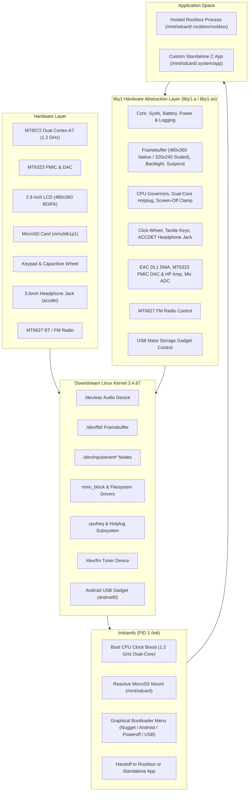
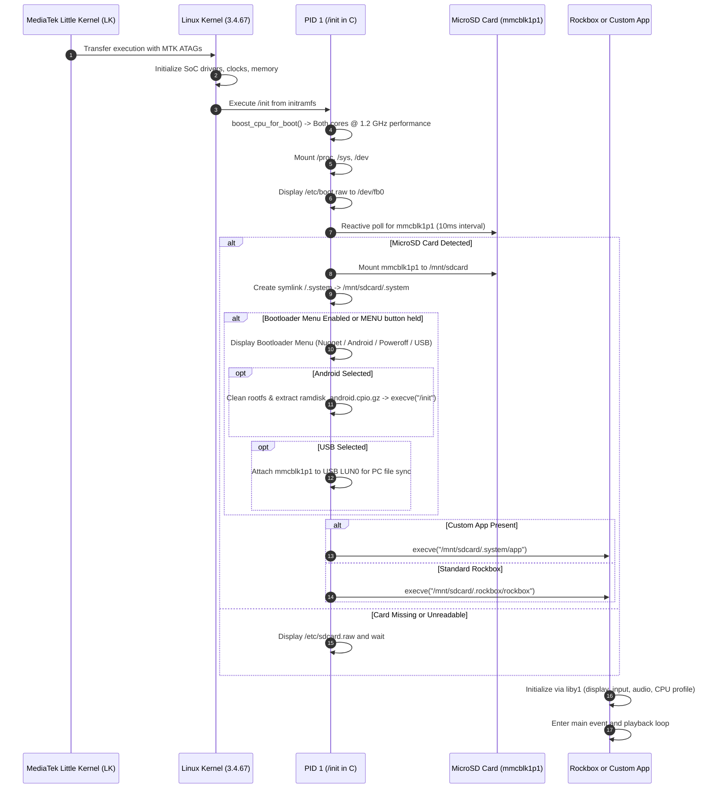

🌐 [한국어](kr/ARCHITECTURE.md) | **English**

# System Architecture: Innioasis Y1 Hosted Linux Port

This document details the software architecture, process model, boot lifecycle, and storage layout of the Innioasis Y1 Rockbox port and `liby1` Hardware SDK on minimal downstream Linux.

---

## 1. System Block Diagram



---

## 2. Boot Sequence & Process Lifecycle



---

## 3. Storage Hierarchy & Partitioning

The hardware contains internal eMMC (`mmcblk0`) and external MicroSD (`mmcblk1`).

### 3.1 Partition Scheme
- `mmcblk0` (Internal eMMC): Contains stock MediaTek partitions (`BOOTIMG`, `RECOVERY`, `LOGO`, `SYSTEM`, `CACHE`, `DATA`). Rockbox overwrites only the `BOOTIMG` partition with `boot_rockbox.img` (6 MiB max). The rest of eMMC is left untouched.
- `mmcblk1p1` (External MicroSD): Formatted as FAT32, exFAT, NTFS, or ext4. Houses system libraries, hardware SDK assets, and application data:

```text
/mnt/sdcard/
|-- .system/                      # System, hardware, and developer files (symlinked to /.system)
|   |-- lib/
|   |   |-- liby1.so              # Dynamic liby1 hardware abstraction library
|   |   |-- liby1.a               # Static liby1 library
|   |   `-- liby1video.so         # NEON H.264/AAC hardware video decoder
|   |-- include/
|   |   `-- liby1.h               # Public C header
|   |-- bin/
|   |   `-- ffmpeg                # Static ARM FFmpeg binary (optional)
|   |-- bt/                       # Bluetooth modules & firmware
|   |-- bt_paired.dat             # Paired devices database
|   |-- ramdisk_android.cpio.gz   # Stock Android ramdisk for dual-boot
|   |-- y1_debug.txt              # Hardware diagnostic log
|   |-- system.cfg                # Bootloader menu configuration
|   |-- *.raw                     # Splash and bootloader menu screens
|   `-- app                       # Optional standalone user executable
|-- .rockbox/                     # Rockbox-only assets
|   |-- rockbox                   # ELF ARM hard-float executable
|   |-- codecs/                   # Audio decoders (.codec)
|   |-- rocks/                    # Plugins and viewers (.rock, .ovl)
|   |-- fonts/                    # UI fonts (.fnt, .fnticons)
|   |-- themes/                   # Theme configurations (.cfg)
|   |-- wps/                      # While Playing Screen skins (.wps, .sbs)
|   `-- config.cfg                # Rockbox persisted settings
|-- Videos/                       # Video files
`-- Music/                        # Music library
```

---

## 4. Hardware Abstraction Layer (`liby1`) Mapping

| Subsystem | `liby1` Module | Technical Role |
| :--- | :--- | :--- |
| Core / Power / Battery | [`hosted_linux_port/liby1/src/y1_core.c`](file:///c:/Users/dakirb/Documents/rom/!rockbox_fromsource/rockbox-master/rockbox-master/hosted_linux_port/liby1/src/y1_core.c) | System initialization, MT6323 PMIC register access, battery telemetry, and `/mnt/sdcard/.system/y1_debug.txt` logging. |
| Display & Backlight | [`hosted_linux_port/liby1/src/y1_display.c`](file:///c:/Users/dakirb/Documents/rom/!rockbox_fromsource/rockbox-master/rockbox-master/hosted_linux_port/liby1/src/y1_display.c) | Framebuffer writing (`/dev/graphics/fb0`), 480x360 native, 320x240 classic bilinear upscaler, and kernel early suspend. |
| CPU Frequency & Hotplug | [`hosted_linux_port/liby1/src/y1_cpu.c`](file:///c:/Users/dakirb/Documents/rom/!rockbox_fromsource/rockbox-master/rockbox-master/hosted_linux_port/liby1/src/y1_cpu.c) | cpufreq scaling (598MHz powersave to 1.3GHz turbo), CPU1 core offlining, and screen-off clamp. |
| Input & Click-Wheel | [`hosted_linux_port/liby1/src/y1_input.c`](file:///c:/Users/dakirb/Documents/rom/!rockbox_fromsource/rockbox-master/rockbox-master/hosted_linux_port/liby1/src/y1_input.c) | Translates `evdev` events from click wheel, tactile buttons, and ACCDET 3.5mm headphone jack. |
| Audio Subsystem | [`hosted_linux_port/liby1/src/y1_audio.c`](file:///c:/Users/dakirb/Documents/rom/!rockbox_fromsource/rockbox-master/rockbox-master/hosted_linux_port/liby1/src/y1_audio.c) | `/dev/eac` AFE DL1 DMA setup, MT6323 PMIC DAC & Headphone Amp gain staging, 4-byte frame alignment, and deep-idle SPM powerdown gating. |
| FM Radio Tuner | [`hosted_linux_port/liby1/src/y1_tuner.c`](file:///c:/Users/dakirb/Documents/rom/!rockbox_fromsource/rockbox-master/rockbox-master/hosted_linux_port/liby1/src/y1_tuner.c) | MT6627 FM radio control via `/dev/fm` ioctls. |
| USB Gadget | [`hosted_linux_port/liby1/src/y1_usb.c`](file:///c:/Users/dakirb/Documents/rom/!rockbox_fromsource/rockbox-master/rockbox-master/hosted_linux_port/liby1/src/y1_usb.c) | Android USB Mass Storage LUN0 bind/unbind for PC music transfer. |
