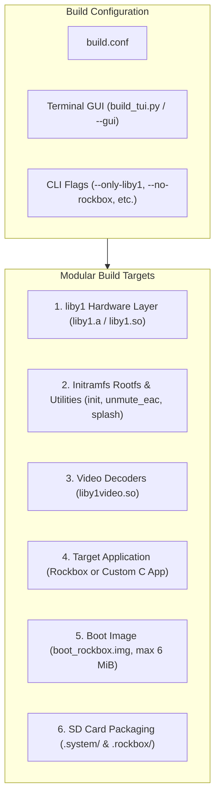

🌐 [한국어](kr/BUILD_GUIDE.md) | **English**

# Innioasis Y1 Modular Build System & Configuration Guide

This guide details the decoupled build architecture, configuration options, interactive Terminal GUI (TUI), command-line flags, and deployment procedures for the **Innioasis Y1 Hosted Linux Port** and **`liby1` Hardware SDK**.

---

## 1. Overview of the Decoupled Architecture

The Innioasis Y1 software stack is split into fully independent, modular components:



### Key Architectural Advantages
1. **Rockbox Decoupling:** Rockbox is no longer hard-wired into the build scripts. You can build a minimal standalone Linux SDK without compiling Rockbox, or build and package a custom third-party C binary directly onto the device.
2. **Dedicated `.system` Storage:** All system libraries (`liby1.so`), headers (`liby1.h`), Bluetooth kernel modules (`bt/`), splash screens (`*.raw`), and debug logs (`y1_debug.txt`) live inside `/mnt/sdcard/.system/` (symlinked at `/.system`). Rockbox-specific files live strictly inside `/mnt/sdcard/.rockbox/`.
3. **Hardware Abstraction Layer (`liby1`):** Both Rockbox and custom standalone applications link against the same unified, zero-dependency C library (`liby1`).
4. **Interactive Configuration:** A terminal-based graphical menu (`./build.sh --gui`) lets you visually toggle build components, choose compilation jobs, and set paths without manual script editing.

---

## 2. Prerequisites

### Host Operating System
- **Supported:** Ubuntu 20.04+, Debian 11+, WSL2 (Windows Subsystem for Linux on Windows 10/11).
- **Architecture:** x86_64 or aarch64.

### Required Packages
Install the ARM cross-compiler toolchain, Python 3, compression utilities, and build tools:
```bash
sudo apt update
sudo apt install -y \
    build-essential \
    gcc-arm-linux-gnueabihf \
    g++-arm-linux-gnueabihf \
    python3 \
    python3-pip \
    zip \
    curl \
    ccache
```

---

## 3. Configuration & Interactive Terminal GUI (TUI)

The build system can be configured either by launching the interactive Terminal GUI or by editing `hosted_linux_port/build.conf`.

### 3.1 Launching the Terminal GUI
Run any of the following commands from `hosted_linux_port/`:
```bash
./build.sh --gui
# Or:
./build.sh menuconfig
# Or directly via Python:
python3 tools/build_tui.py build.conf
```

#### GUI Controls
* **Up / Down Arrows (or `k` / `j`):** Navigate through configuration options and quick actions.
* **Spacebar:** Toggle boolean options `[X]` / `[ ]` or edit text fields.
* **Enter:** Activate highlighted action or edit field.
* **`S`:** Save configuration to `build.conf` and exit.
* **`B`:** Save configuration and immediately execute the build.
* **`Q` (or `ESC`):** Quit without saving.

### 3.2 Configuration File (`build.conf`)
Located at [`hosted_linux_port/build.conf`](../build.conf):

| Parameter | Default | Description |
| :--- | :--- | :--- |
| `BUILD_LIBY1` | `1` | Compiles the standalone C hardware library (`liby1.a`, `liby1.so`, `hello_y1`). |
| `BUILD_ROOTFS` | `1` | Assembles minimal rootfs, converts splash PNGs to RAW, and compiles `init` and `unmute_eac`. |
| `BUILD_BOOTIMG` | `1` | Packages rootfs into `ramdisk_rockbox.img` and MTK kernel boot image `boot_rockbox.img`. |
| `BUILD_VIDEO_LIB` | `1` | Builds hardware video helper `liby1video.so` (NEON H.264/AAC). |
| `BUILD_ROCKBOX` | `1` | Compiles Rockbox application targeting the Innioasis Y1 (`build_y1/`). |
| `PACKAGE_SDCARD` | `1` | Generates the SD card deployment archive (`rockbox_sdcard.zip` or `y1_sdcard.zip`). |
| `BUNDLE_BT_BLOBS` | `1` | Copies MediaTek MT6572/MT6627 Bluetooth `.ko` modules and firmware into `/.system/bt/`. |
| `BUNDLE_ANDROID_RAMDISK` | `1` | Copies stock Android ramdisk to `/.system/ramdisk_android.cpio.gz` for Bootloader Menu dual-boot. |
| `CUSTOM_APP_BIN` | `""` | Optional path to an ARM executable to install at `/.system/app`. If present, `/init` launches this instead of Rockbox. |
| `CROSS_COMPILE` | `"arm-linux-gnueabihf-"` | Prefix for the ARM cross-compiler toolchain. |
| `USE_CCACHE` | `1` | Accelerates incremental rebuilds using `ccache` (if installed). |
| `JOBS` | `0` | Parallel make jobs (`0` = auto-detect CPU cores via `nproc`). |

---

## 4. Command-Line Usage & Quick Builds

`build.sh` accepts command-line arguments to override `build.conf` for scripted or fast incremental builds:

### Full Standard Build (Rockbox + Boot Image + SD Card)
```bash
./build.sh
```

### GitHub Release Distribution Package (dist/)
To build and package all ready-to-upload assets for a GitHub Release:
```bash
# Run one-step distribution build:
./build.sh --dist
# Or run the packaging tool directly:
./tools/make_dist.sh
```
This automatically compiles all components, packages `liby1-sdk.zip`, computes `sha256sums.txt`, and generates `RELEASE_NOTES.md` inside `hosted_linux_port/dist/`:
* `dist/boot_rockbox.img` (Flashable MT6572 boot image)
* `dist/rockbox_sdcard.zip` (Complete MicroSD package: `.rockbox/` + `.system/`)
* `dist/liby1-sdk.zip` (C hardware layer headers, static/shared libs, and examples)
* `dist/sha256sums.txt` (SHA-256 integrity checksums)
* `dist/RELEASE_NOTES.md` (Release notes template)

### Standalone SDK Build (No Rockbox)
Builds `liby1`, the Linux rootfs, the boot image, and SD card `.system/` SDK package without touching Rockbox:
```bash
./build.sh --no-rockbox
```

### Quick Component Builds
```bash
# Build ONLY liby1 (liby1.a, liby1.so, and examples/hello_y1)
./build.sh --only-liby1

# Build ONLY the Linux initramfs rootfs and native utilities (init, unmute_eac)
./build.sh --only-rootfs

# Build ONLY liby1, rootfs, and flashable boot_rockbox.img
./build.sh --only-bootimg

# Build ONLY the video decoder library (liby1video.so)
./build.sh --only-video
```

### Deploying a Custom C Binary
If you have written a custom application (e.g., using `liby1`):
```bash
./build.sh --no-rockbox --custom-app /path/to/my_arm_app
```
This stages your executable at `/.system/app` inside the SD card archive. When the device powers on, `/init` detects `/.system/app` and boots directly into it.

---

## 5. Build Artifacts & Output

After a successful build, the following files are produced in `hosted_linux_port/`:

| Artifact | Size | Description |
| :--- | :--- | :--- |
| `boot_rockbox.img` | $\le$ 6 MiB | **Flashable Boot Image:** Contains the MT6572 vendor Linux kernel and minimal initramfs ramdisk (`/init`, BusyBox, runtime glibc). Flash this to the device's `BOOTIMG` partition. |
| `rockbox_sdcard.zip` | ~15–30 MB | **Complete SD Distribution:** Contains `.rockbox/` (Rockbox binary, codecs, themes, fonts) and `.system/` (hardware libraries, Bluetooth modules, bootloader screens). |
| `y1_sdcard.zip` | ~5–10 MB | **Standalone SDK SD Distribution:** (Generated when `BUILD_ROCKBOX=0`). Contains strictly `.system/` and system utilities. |
| `liby1/build/liby1.a` | ~120 KB | Static library archive for `liby1`. |
| `liby1/build/liby1.so` | ~90 KB | Dynamic shared object library for `liby1`. |

---

## 6. Installation & Flashing Instructions

### Step 1: Flashing `boot_rockbox.img`
> [!IMPORTANT]
> The internal eMMC `BOOTIMG` partition size limit on the Innioasis Y1 is **6,291,456 bytes (6 MiB)**. `build.sh` automatically enforces this limit.

#### Option A: SP Flash Tool (Recommended for MediaTek MT6572)
1. Launch **SP Flash Tool** on your PC.
2. Load the MT6572 scatter file from your stock ROM dump (`MT6572_Android_scatter.txt`).
3. In the partition table list:
   - Check **ONLY** the `BOOTIMG` row.
   - Uncheck all other partitions (`PRELOADER`, `RECOVERY`, `SYSTEM`, etc.).
   - Double-click the `BOOTIMG` location path and select `hosted_linux_port/boot_rockbox.img`.
4. Click **Download**.
5. Power off the Y1 completely, then connect it to your PC via USB while holding the Center or Menu button (or simply plug in). SP Flash Tool will flash the partition in under 3 seconds.

#### Option B: Fastboot (if bootloader is unlocked)
```bash
fastboot flash boot hosted_linux_port/boot_rockbox.img
fastboot reboot
```

### Step 2: Extracting SD Card Assets
1. Format a MicroSD card as **FAT32** (or exFAT).
2. Extract the generated `rockbox_sdcard.zip` directly onto the root of the MicroSD card:
   ```text
   / (SD Card Root)
   |-- .system/
   |   |-- lib/
   |   |   |-- liby1.so
   |   |   |-- liby1video.so
   |   |-- include/
   |   |   |-- liby1.h
   |   |-- bt/
   |   |-- ramdisk_android.cpio.gz
   |   |-- y1_debug.txt
   |   |-- bootl_*.raw
   |-- .rockbox/
   |   |-- rockbox
   |   |-- codecs/
   |   |-- rocks/
   |   |-- wps/
   |-- Videos/
   ```
3. Insert the MicroSD card into the Y1 and turn on the device.

---

## 7. Dual-Boot Configuration & Bootloader Menu

The initramfs `/init` includes a multi-option graphical Bootloader Menu displayed before any application launches:
* **Pick 1 (Nugget):** Boots Rockbox or custom app.
* **Pick 2 (Android):** Replaces rootfs with stock Android ramdisk (`ramdisk_android.cpio.gz`) and launches Android OS.
* **Pick 3 (Shut Down):** Safely powers down the device.
* **Pick 4 (USB Mode):** Binds MicroSD to USB Mass Storage LUN0 for PC file transfer.

### Always-On Menu Bypass
Holding the **MENU** button while powering on the device will **always** force display of the Bootloader Menu, regardless of any automatic boot timeouts configured in `.system/system.cfg`.

