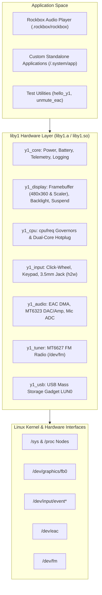

🌐 [한국어](kr/LIBY1_GUIDE.md) | **English**

# `liby1` — Innioasis Y1 Hardware Abstraction Layer & Developer Manual

`liby1` is a zero-dependency, self-contained C library that wraps all hardware drivers, sysfs controls, and kernel ioctl interfaces for the **Innioasis Y1** (MediaTek MT6572 SoC, MT6323 PMIC, and MT6627 wireless combo).

It provides C/C++ developers with an official, production-tested hardware abstraction layer (HAL) to create standalone games, emulators, custom media players, and utilities without reverse-engineering low-level register maps or kernel nodes. Rockbox itself utilizes `liby1` under the hood.

---

## 1. Architecture & Design Rationale

### Why `liby1`?
Historically, code targeting the Innioasis Y1 was embedded directly within Rockbox's target drivers (`firmware/target/hosted/innioasis/y1/`). This made it difficult for external developers to utilize the hardware or test independent software.

`liby1` completely decouples hardware management from application logic:



### Key Highlights
* **Zero Dependencies:** Written in standard C99/C11 against standard Linux headers; requires only standard glibc.
* **Dual Packaging:** Compiles to both a static library (`liby1.a`) for single-binary distribution and a shared library (`liby1.so`) for dynamic linking.
* **Separation of Concerns:** All system files, runtime libraries, and headers live in `/mnt/sdcard/.system/` (symlinked at `/.system`).

---

## 2. Directory Layout & SD Card Structure

All system, hardware, and developer assets reside cleanly inside `/mnt/sdcard/.system/`:

```text
/mnt/sdcard/
|-- .system/                      # Symlinked to /.system at boot
|   |-- include/
|   |   `-- liby1.h               # Public C header file
|   |-- lib/
|   |   |-- liby1.so              # Dynamic shared hardware library
|   |   |-- liby1.a               # Static hardware library archive
|   |   `-- liby1video.so         # NEON H.264/AAC hardware video decoder
|   |-- bin/
|   |   `-- ffmpeg                # Static ARM FFmpeg binary (optional)
|   |-- bt/                       # Bluetooth firmware & kernel modules (*.ko)
|   |-- bt_paired.dat             # Paired Bluetooth devices database
|   |-- ramdisk_android.cpio.gz   # Stock Android ramdisk for dual-boot
|   |-- y1_debug.txt              # System diagnostic log
|   `-- app                       # Optional standalone user executable
|-- .rockbox/                     # Rockbox-only assets (clean & isolated)
|   |-- rockbox
|   `-- config.cfg
`-- Videos/
```

---

## 3. Subsystem API Reference

All declarations are found in [`hosted_linux_port/liby1/include/liby1.h`](../liby1/include/liby1.h).

### 3.1 Core, Power, Battery & Logging (`y1_core.c`)
Manages global initialization, power states, battery telemetry, and logging to `/mnt/sdcard/.system/y1_debug.txt`.

```c
#include "liby1.h"

// Lifecycle
int  y1_init(void);     // Initializes display, backlight, input, audio
void y1_shutdown(void); // Graceful hardware power-down

// Diagnostic Logging
void y1_log_set_enabled(bool enabled);
void y1_log(const char *msg);
void y1_logf(const char *fmt, ...);

// Battery & Power Telemetry
int  y1_battery_percent(void);    // 0 to 100 %
int  y1_battery_voltage_mv(void); // e.g. 3850 mV
int  y1_battery_current_ma(void); // Real-time discharge/charge current (mA)
bool y1_battery_is_charging(void);
bool y1_power_usb_online(void);   // Returns true if connected to 5V USB/charger

// Power Actions
void y1_sys_poweroff(void); // Performs clean hardware power-off
void y1_sys_reboot(void);   // Reboots the SoC
```

### 3.2 Display, Framebuffer, Backlight & Early Suspend (`y1_display.c`)
Direct access to the 480x360 2.8" color LCD (`/dev/graphics/fb0`) with hardware overlay panning, bilinear classic mode upscaling, and low-power kernel suspend.

```c
// Framebuffer Initialization
int  y1_fb_init(void);
void y1_fb_close(void);
int  y1_fb_width(void);       // 480
int  y1_fb_height(void);      // 360
uint8_t *y1_fb_mmap_ptr(void);// Direct mmap pointer to 32-bit XRGB framebuffer

// Frame Presentation
void y1_fb_present_xrgb8888(const uint32_t *pixels_480x360);
void y1_fb_present_rgb565(const uint16_t *pixels_480x360);

// Smooth 320x240 to 480x360 Area-Averaged Upscaler (Classic Mode)
void y1_fb_blit_rgb565_classic_scaled(const uint16_t *src_base, int src_stride_px,
                                      int x, int y, int width, int height,
                                      y1_pixel_blend_fn blend_cb, void *blend_user);

// Direct RAW Screen Rendering (Loads 480x360 BGRA screens from /.system/<name>.raw)
bool y1_fb_display_raw_screen(const char *name, uint16_t *out_fb16,
                              int fb16_stride_px, bool classic_320x240);

// Backlight & Screen Sleep
void y1_backlight_set_percent(int pct_0_to_100);
void y1_backlight_set_raw(int val_0_to_255);
void y1_display_enter_early_suspend(void); // Powers off LCD clocks, touch scanning, and GPU
void y1_display_exit_early_suspend(void);  // Wakes display controller back to 'on' state
```

### 3.3 CPU Frequency Governors & Hotplug (`y1_cpu.c`)
Controls MT6572 CPU clock states and the secondary Cortex-A7 core to maximize battery life.

```c
// CPU Profile Modes
y1_cpu_set_mode(Y1_CPU_MODE_POWERSAVE);   // Clamps to 598 MHz (Lowest VCORE 1.05V)
y1_cpu_set_mode(Y1_CPU_MODE_DYNAMIC);     // Ondemand 598 MHz - 1001 MHz
y1_cpu_set_mode(Y1_CPU_MODE_PERFORMANCE); // Fixed 1196 MHz dual-core

// Dual-Core Hotplug
y1_cpu_set_dual_core(false);              // Offlines CPU1 for power savings
y1_cpu_set_dual_core(true);               // Onlines CPU1 for multithreaded tasks
int freq = y1_cpu_get_freq_mhz();         // Queries current clock in MHz
```

### 3.4 Input: Click-Wheel, Tactile Keys & 3.5mm Jack (`y1_input.c`)
Polls input events from `/dev/input/event*`, maps capacitive wheel rotations, and monitors the headphone jack.

```c
int y1_input_init(void);

struct y1_input_event ev;
// Non-blocking poll (timeout_ms: 0 = immediate, -1 = infinite wait)
if (y1_input_poll(&ev, 100) > 0) {
    if (ev.value == 1) { // Key Press
        switch (ev.button) {
            case Y1_BTN_SELECT:      /* Center button */ break;
            case Y1_BTN_MENU:        /* Menu button */ break;
            case Y1_BTN_PLAY:        /* Play/Pause */ break;
            case Y1_BTN_SCROLL_FWD:  /* Clockwise wheel scroll */ break;
            case Y1_BTN_SCROLL_BACK: /* Counter-clockwise wheel scroll */ break;
            case Y1_BTN_VOL_UP:      /* Side volume + */ break;
            case Y1_BTN_VOL_DOWN:    /* Side volume - */ break;
            case Y1_BTN_HEADSET_MFB: /* Headphone inline button */ break;
        }
    }
}

// 3.5mm Headphone Jack
bool plugged = y1_jack_is_inserted();
bool has_mic = y1_jack_has_mic(); // True if 4-pole TRRS headset
```

### 3.5 Audio Subsystem: EAC DMA & MT6323 PMIC DAC (`y1_audio.c`)
Bit-perfect 44.1 kHz and 48 kHz stereo playback via `/dev/eac` and the MT6323 PMIC DAC and headphone amplifier.

```c
// Open EAC audio device with chosen sample rate (e.g. 44100 or 48000 Hz)
if (y1_audio_open(44100) == 0) {
    // Set analog PGA headphone volume (0 to 7; 0 = -12 dB, 7 = +2 dB)
    y1_audio_set_hp_analog_gain(6, 6);

    // Submit 16-bit interleaved stereo PCM frames
    // (DMA automatically handles 4-byte frame alignment)
    int16_t pcm_buffer[1024 * 2]; // 1024 stereo frames
    y1_audio_write_pcm(pcm_buffer, sizeof(pcm_buffer));

    // Release when finished
    y1_audio_close();
}
```

### 3.6 FM Radio Tuner (`y1_tuner.c`)
Controls the MT6627 wireless combo chip FM tuner via `/dev/fm`.

```c
y1_fm_power(true);
y1_fm_tune(98500000); // 98.5 MHz
int rssi = y1_fm_get_rssi();
bool locked = y1_fm_is_tuned();
y1_fm_set_mute(false);
```

### 3.7 USB Mass Storage Gadget (`y1_usb.c`)
Toggles the Android USB Mass Storage gadget to mount the physical MicroSD partition (`/dev/block/mmcblk1p1`) onto a connected PC.

```c
// Attach MicroSD as USB Mass Storage drive for PC music syncing
y1_usb_attach_mass_storage();

// Check if user safely ejected the drive from host PC
if (y1_usb_check_host_ejected()) {
    y1_usb_detach_mass_storage();
}
```

---

## 4. Writing & Compiling Standalone Applications

### 4.1 Minimal Example (`examples/hello_y1.c`)
```c
#include <stdio.h>
#include <unistd.h>
#include "liby1.h"

int main(void) {
    if (y1_init() != 0) {
        fprintf(stderr, "Failed to initialize liby1\n");
        return 1;
    }

    y1_log("Hello from a standalone Innioasis Y1 application!");

    // Turn screen on with 70% brightness
    y1_backlight_set_percent(70);

    // Display a built-in RAW splash screen
    y1_fb_display_raw_screen("boot", NULL, 0, false);

    printf("Battery: %d%% (%d mV)\n",
           y1_battery_percent(), y1_battery_voltage_mv());

    // Wait for Center Button or Menu Button to quit
    struct y1_input_event ev;
    bool running = true;
    while (running) {
        if (y1_input_poll(&ev, 100) > 0 && ev.value == 1) {
            if (ev.button == Y1_BTN_SELECT || ev.button == Y1_BTN_MENU) {
                running = false;
            }
        }
    }

    y1_shutdown();
    return 0;
}
```

### 4.2 Building with the Standalone Makefile
```bash
# Build liby1.a, liby1.so, and examples/hello_y1
make -C hosted_linux_port/liby1 CROSS_COMPILE=arm-linux-gnueabihf-
```

### 4.3 Manual Compilation & Linking
To build your own C file using the static archive:
```bash
arm-linux-gnueabihf-gcc -O2 \
    -Ihosted_linux_port/liby1/include \
    my_app.c \
    hosted_linux_port/liby1/build/liby1.a \
    -o my_app
```

To link dynamically against `liby1.so`:
```bash
arm-linux-gnueabihf-gcc -O2 \
    -Ihosted_linux_port/liby1/include \
    -Wl,-rpath,/.system/lib \
    my_app.c \
    -Lhosted_linux_port/liby1/build -ly1 \
    -o my_app
```

---

## 5. Running Standalone Applications at Boot

You can run your standalone application on the Innioasis Y1 without Rockbox:
1. Copy your compiled ARM executable to `/mnt/sdcard/.system/app`.
2. Ensure it has execution permissions (`chmod +x /mnt/sdcard/.system/app`).
3. Power on the device.
4. The initramfs `/init` detects `/.system/app` and executes it directly with full hardware access.

