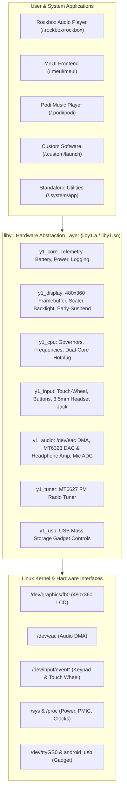

🌐 [한국어](kr/LIBY1_GUIDE.md) | **English**

# `liby1` — Innioasis Y1 Hardware Abstraction Layer & Porting Guide

`liby1` is a zero-dependency, self-contained C library that wraps all hardware drivers, sysfs controls, and kernel ioctl interfaces for the **Innioasis Y1** (MediaTek MT6572 SoC, MT6323 PMIC, and MT6627 wireless combo).

It provides C/C++ developers with an official, production-tested hardware abstraction layer (HAL) to create standalone games, emulators, custom media players, GUI frontends, and utilities without needing to reverse-engineer low-level register maps, sysfs paths, or kernel ioctls.

---

## Table of Contents
1. [Target Platform & Hardware Architecture](#1-target-platform--hardware-architecture)
2. [Software Execution & Bootloader Integration](#2-software-execution--bootloader-integration)
3. [SD Card File System Structure](#3-sd-card-file-system-structure)
4. [Subsystem API Reference](#4-subsystem-api-reference)
   - [4.1 Core, Power, Battery & Telemetry (`y1_core`)](#41-core-power-battery--telemetry-y1_core)
   - [4.2 Display, Framebuffer, Backlight & Sleep (`y1_display`)](#42-display-framebuffer-backlight--sleep-y1_display)
   - [4.3 CPU Frequency Governors & Hotplug (`y1_cpu`)](#43-cpu-frequency-governors--hotplug-y1_cpu)
   - [4.4 Input: Click-Wheel, Tactile Keys & 3.5mm Jack (`y1_input`)](#44-input-click-wheel-tactile-keys--35mm-jack-y1_input)
   - [4.5 Audio: EAC DMA & MT6323 PMIC DAC/Amp (`y1_audio`)](#45-audio-eac-dma--mt6323-pmic-dacamp-y1_audio)
   - [4.6 FM Radio Tuner (`y1_tuner`)](#46-fm-radio-tuner-y1_tuner)
   - [4.7 USB Mass Storage Gadget (`y1_usb`)](#47-usb-mass-storage-gadget-y1_usb)
5. [Porting Guide: Bringing Your Own Experience to Y1](#5-porting-guide-bringing-your-own-experience-to-y1)
   - [5.1 The Standard Y1 Main Loop Architecture](#51-the-standard-y1-main-loop-architecture)
   - [5.2 Porting Framebuffer / SDL / Raylib / LVGL Applications](#52-porting-framebuffer--sdl--raylib--lvgl-applications)
   - [5.3 Packaging for MeUI, Podi, or Custom Software Picks](#53-packaging-for-meui-podi-or-custom-software-picks)
6. [Interactive USB Serial Debugging (Pick 8)](#6-interactive-usb-serial-debugging-pick-8)
7. [Hardware Safety Watchdog (10-Second Force Shutdown)](#7-hardware-safety-watchdog-10-second-force-shutdown)
8. [Complete Working Code Example: Interactive Game Demo](#8-complete-working-code-example-interactive-game-demo)
9. [Build Environment & Makefile Template](#9-build-environment--makefile-template)

---

## 1. Target Platform & Hardware Architecture

The Innioasis Y1 is a dedicated digital audio player powered by a modern Linux kernel:

| Specification | Innioasis Y1 Details |
| :--- | :--- |
| **SoC** | MediaTek MT6572 (2x ARM Cortex-A7 @ 598 MHz – 1.30 GHz) |
| **Instruction Set** | ARMv7-A with NEON SIMD and VFPv4 (Target: `arm-linux-gnueabihf`) |
| **RAM** | 512 MB LPDDR2 |
| **Display** | 2.8-inch IPS LCD, **480x360 native resolution** (RGB565 / XRGB8888 on `/dev/fb0`) |
| **Audio DAC/Amp** | MediaTek MT6323 PMIC Hi-Fi Stereo DAC & Analog PGA Headphone Amp (8 kHz – 48 kHz, 16-bit stereo) |
| **Input** | Capacitive Touch Click-Wheel (Clockwise & Counter-Clockwise scrolls), 5 tactile wheel buttons (Select, Menu, Play/Pause, Prev, Next) |
| **Headphone Jack** | 3.5mm TRRS with automatic jack detection, microphone bias, and inline MFB remote monitoring |
| **Connectivity** | USB 2.0 High-Speed OTG/Client (Mass Storage, USB Serial Terminal ACM), Bluetooth 4.0 (MT6627), FM Radio |
| **Storage** | MicroSD slot (supports SDSC, SDHC, and SDXC up to 2TB FAT32/exFAT/ext4) |



---

## 2. Software Execution & Bootloader Integration

The Y1 bootloader initramfs (`init.c`) provides seamless multi-experience launching directly from the physical MicroSD card.

### Dynamic Bootloader Carousel (Hold `MENU` at Boot)
Holding the **MENU** button at power-on brings up the visual carousel menu. The menu dynamically discovers and displays only software that is physically installed on the SD card:

1. **Pick 1: Rockbox** — Always present (`/.rockbox/rockbox` or `/mnt/sdcard/.rockbox/rockbox`).
2. **Pick 2: MeUI** — Displayed only if `/mnt/sdcard/.meui/meui` or `/.meui/meui` exists.
3. **Pick 3: Podi** — Displayed only if `/mnt/sdcard/.podi/podi` or `/.podi/podi` exists.
4. **Pick 4: Custom Software** — Displayed only if `/mnt/sdcard/.custom/launch` or `/.custom/launch` exists.
5. **Pick 5: Android** — Reboots cleanly into the stock Android ROM partition.
6. **Pick 6: Shut down** — Immediate clean hardware power off.
7. **Pick 7: USB Mass Storage** — Mounts the MicroSD card to a connected PC for file transfers.
8. **Pick 8: Linux terminal (USB)** — Spawns an interactive root rescue shell on `/dev/ttyGS0`.

### Execution Environment
When your application is launched from the bootloader or as `/.system/app`:
- **Working Directory:** `/mnt/sdcard` (or application root)
- **Environment Variables:**
  - `PATH=/bin:/sbin:/usr/bin:/usr/sbin:/mnt/sdcard/.system/bin:/mnt/sdcard/.rockbox/bin:/mnt/sdcard/.meui/bin:/mnt/sdcard/.podi/bin:/mnt/sdcard/.custom/bin`
  - `LD_LIBRARY_PATH=/mnt/sdcard/.meui/lib:/mnt/sdcard/.podi/lib:/mnt/sdcard/.custom/lib:/mnt/sdcard/.system/lib:/mnt/sdcard/.rockbox/lib:/lib:/usr/lib`
  - `HOME=/mnt/sdcard`
  - `TERM=linux`

---

## 3. SD Card File System Structure

Deploying an application to the Y1 requires no flashing. Simply copy your binary and assets onto the FAT32 partition of the MicroSD card:

```text
/mnt/sdcard/ (MicroSD Root)
|-- .system/                      # Shared system directory (symlinked to /.system)
|   |-- include/liby1.h           # Public C API header
|   |-- lib/liby1.a               # Static hardware library for offline linking
|   |-- lib/liby1.so              # Shared hardware library
|   |-- lib/liby1video.so         # NEON-accelerated H.264/AAC video decoder
|   |-- bin/                      # Auxiliary tools (e.g. ffmpeg)
|   |-- bt/                       # Bluetooth firmware & kernel modules (*.ko)
|   |-- y1_debug.txt              # Live hardware diagnostic log
|   `-- app                       # Optional default auto-boot application
|-- .custom/                      # Pick 4: User defined software
|   |-- launch                    # Main executable (ELF binary or shell script)
|   |-- bin/                      # Custom binaries
|   `-- lib/                      # Custom shared libraries (.so)
|-- .meui/                        # Pick 2: MeUI frontend
|   |-- meui                      # Executable
|   `-- lib/                      # Shared libraries
|-- .podi/                        # Pick 3: Podi music player
|   |-- podi                      # Executable
|   `-- lib/                      # Shared libraries
`-- .rockbox/                     # Pick 1: Rockbox player suite
    `-- rockbox                   # Rockbox executable
```

---

## 4. Subsystem API Reference

All declarations are exposed in [`hosted_linux_port/liby1/include/liby1.h`](file:///c:/Users/dakirb/Documents/rom/!rockbox_fromsource/rockbox-master/rockbox-master/hosted_linux_port/liby1/include/liby1.h).

### 4.1 Core, Power, Battery & Telemetry (`y1_core`)
```c
#include "liby1.h"

// Lifecycle
int  y1_init(void);     // Initializes display, backlight, input, and audio subsystems
void y1_shutdown(void); // Graceful hardware power-down

// Diagnostic Logging
void y1_log_set_enabled(bool enabled);
void y1_log(const char *msg);
void y1_logf(const char *fmt, ...);

// Battery & Power Telemetry
int  y1_battery_percent(void);    // State of charge: 0 to 100 %
int  y1_battery_voltage_mv(void); // Real-time voltage in millivolts (e.g. 3850 mV)
int  y1_battery_current_ma(void); // Real-time discharge/charge current (mA)
bool y1_battery_is_charging(void);
bool y1_power_usb_online(void);   // Returns true if 5V USB/charger is connected

// System Power Control
void y1_sys_poweroff(void); // Syncs filesystems and powers off the device
void y1_sys_reboot(void);   // Reboots the SoC
```

### 4.2 Display, Framebuffer, Backlight & Sleep (`y1_display`)
The Y1 display is a 480x360 24-bit IPS panel. `liby1` exposes high-performance presentation functions supporting RGB565 and XRGB8888, bilinear scaling, and low-power kernel suspend:

```c
// Geometry & Pointers
int      y1_fb_init(void);
void     y1_fb_close(void);
int      y1_fb_width(void);       // 480
int      y1_fb_height(void);      // 360
uint8_t *y1_fb_mmap_ptr(void);    // Direct pointer to mapped 32-bit framebuffer

// Frame Presentation
void y1_fb_present_rgb565(const uint16_t *pixels_480x360);
void y1_fb_present_xrgb8888(const uint32_t *pixels_480x360);
void y1_fb_flip(void);            // Hardware overlay pan refresh (FBIOPAN_DISPLAY)

// Classic Mode Scaler: Smoothly scales 320x240 to 480x360 using 2x2->3x3 area averaging
void y1_fb_blit_rgb565_classic_scaled(const uint16_t *src_base, int src_stride_px,
                                      int x, int y, int width, int height,
                                      y1_pixel_blend_fn blend_cb, void *blend_user);

// Direct RAW Screen Asset Display (Loads 480x360 BGRA screens from /.system/<name>.raw)
bool y1_fb_display_raw_screen(const char *name, uint16_t *out_fb16,
                              int fb16_stride_px, bool classic_320x240);

// Backlight Control
void y1_backlight_set_percent(int pct_0_to_100);
void y1_backlight_set_raw(int val_0_to_255);

// Power Management: Early Suspend
void y1_display_enter_early_suspend(void); // Powers off LCD clocks, backlight, touch, and Mali GPU
void y1_display_exit_early_suspend(void);  // Wakes the display controller back to active state
bool y1_display_is_early_suspended(void);
```

### 4.3 CPU Frequency Governors & Hotplug (`y1_cpu`)
```c
// Governor Modes
y1_cpu_set_mode(Y1_CPU_MODE_POWERSAVE);   // 598 MHz (Lowest VCORE 1.05V, max battery)
y1_cpu_set_mode(Y1_CPU_MODE_DYNAMIC);     // Ondemand governor (598 MHz to 1.00 GHz)
y1_cpu_set_mode(Y1_CPU_MODE_BALANCED);    // Fixed 1.00 GHz
y1_cpu_set_mode(Y1_CPU_MODE_PERFORMANCE); // Fixed 1.20 GHz (Recommended for emulators/video)
y1_cpu_set_mode(Y1_CPU_MODE_TURBO);       // Fixed 1.30 GHz

// Core Hotplug
y1_cpu_set_dual_core(false);              // Offlines CPU1 (saves ~35mA)
y1_cpu_set_dual_core(true);               // Enables dual-core Cortex-A7
int freq = y1_cpu_get_freq_mhz();         // Queries current frequency in MHz
```

### 4.4 Input: Click-Wheel, Tactile Keys & 3.5mm Jack (`y1_input`)
The Innioasis Y1 click-wheel reports tactile buttons as well as capacitive rotations via `/dev/input/event*`:

```c
int y1_input_init(void);

struct y1_input_event ev;
// timeout_ms: 0 = immediate/non-blocking, -1 = infinite wait
if (y1_input_poll(&ev, 16) > 0) {
    if (ev.value == 1) { // Key Down
        switch (ev.button) {
            case Y1_BTN_SELECT:      /* Center Button */ break;
            case Y1_BTN_MENU:        /* Top Menu Button */ break;
            case Y1_BTN_PLAY:        /* Bottom Play/Pause Button */ break;
            case Y1_BTN_LEFT:        /* Left / Previous Track */ break;
            case Y1_BTN_RIGHT:       /* Right / Next Track */ break;
            case Y1_BTN_SCROLL_FWD:  /* Clockwise Wheel Tick */ break;
            case Y1_BTN_SCROLL_BACK: /* Counter-Clockwise Wheel Tick */ break;
            case Y1_BTN_HEADSET_MFB: /* Headphone Cable Inline Remote Button */ break;
        }
    }
}

// Headphone Jack Telemetry
bool inserted = y1_jack_is_inserted();
bool has_mic  = y1_jack_has_mic(); // True if 4-pole TRRS headset
```

### 4.5 Audio: EAC DMA & MT6323 PMIC DAC/Amp (`y1_audio`)
Direct access to the MT6572 Audio Frontend (AFE) DMA engine (`/dev/eac`) and the MT6323 analog headphone amplifier:

```c
// Initialize audio device with desired rate (e.g. 44100 or 48000 Hz)
if (y1_audio_open(44100) == 0) {
    // Set analog PGA headphone volume (0 to 7: 0 = -12 dB, 6 = 0 dB unity, 7 = +2 dB)
    y1_audio_set_hp_analog_gain(6, 6);

    // Keep CPU awake during playback
    y1_audio_wake_lock(true);

    // Write 16-bit interleaved stereo PCM frames
    int16_t pcm_buffer[1024 * 2]; // 1024 stereo frames
    y1_audio_write_pcm(pcm_buffer, sizeof(pcm_buffer));

    // Teardown when finished
    y1_audio_wake_lock(false);
    y1_audio_close();
}
```

### 4.6 FM Radio Tuner (`y1_tuner`)
```c
y1_fm_power(true);
y1_fm_tune(98500000); // 98.5 MHz
int rssi = y1_fm_get_rssi();
bool locked = y1_fm_is_tuned();
y1_fm_set_mute(false);
```

### 4.7 USB Mass Storage Gadget (`y1_usb`)
```c
// Enable PC file syncing mode over USB
y1_usb_attach_mass_storage();

// Poll whether host computer has unmounted/ejected the drive
if (y1_usb_check_host_ejected()) {
    y1_usb_detach_mass_storage();
}
```

---

## 5. Porting Guide: Bringing Your Own Experience to Y1

### 5.1 The Standard Y1 Main Loop Architecture
A standard game or media loop on the Y1 follows this structure:

```c
#include <stdio.h>
#include <stdbool.h>
#include <unistd.h>
#include "liby1.h"

int main(void) {
    // 1. Initialize hardware subsystems
    if (y1_init() != 0) {
        fprintf(stderr, "Failed to initialize liby1 HAL\n");
        return 1;
    }

    // 2. Set CPU profile (Performance for smooth frame pacing)
    y1_cpu_set_mode(Y1_CPU_MODE_PERFORMANCE);
    y1_backlight_set_percent(80);

    // 3. Prepare frame buffer (480x360 RGB565)
    uint16_t frame[480 * 360];

    // 4. Main application loop (~60 FPS)
    bool running = true;
    while (running) {
        // Handle input events
        struct y1_input_event ev;
        while (y1_input_poll(&ev, 0) > 0) {
            if (ev.value == 1) { // Button Press
                if (ev.button == Y1_BTN_MENU)
                    running = false; // Exit to menu
            }
        }

        // Render your scene into 'frame'
        // ... (drawing logic here) ...

        // Present frame to 480x360 LCD
        y1_fb_present_rgb565(frame);

        // Frame timing delay (~16ms)
        usleep(16000);
    }

    // 5. Clean teardown
    y1_cpu_set_mode(Y1_CPU_MODE_DYNAMIC);
    y1_shutdown();
    return 0;
}
```

### 5.2 Porting Framebuffer / SDL / Raylib / LVGL Applications

#### Framebuffer & Direct Memory Rendering
If your engine uses a software pixel canvas:
1. Allocate an off-screen buffer: `uint16_t canvas[480 * 360]` (RGB565) or `uint32_t canvas[480 * 360]` (XRGB8888).
2. Point your renderer's target to `canvas`.
3. Call `y1_fb_present_rgb565(canvas)` or `y1_fb_present_xrgb8888(canvas)` after each frame.
4. Alternatively, write directly to the hardware framebuffer memory via `y1_fb_mmap_ptr()` and call `y1_fb_flip()`.

#### Scaling Retro 320x240 Games (e.g. DOOM, Game Boy, NES)
If porting an engine designed for 320x240:
- Do not spend CPU cycles on software nearest-neighbor scaling in your game loop!
- Simply pass your 320x240 RGB565 buffer to:
  ```c
  y1_fb_blit_rgb565_classic_scaled(source_320x240, 320, 0, 0, 320, 240, NULL, NULL);
  ```
  `liby1` will automatically upscale it to 480x360 with smooth hardware area-averaging.

### 5.3 Packaging for MeUI, Podi, or Custom Software Picks

To have your application automatically appear in the bootloader carousel:

1. **For Pick 4 (User Defined Software):**
   - Place your executable at `/mnt/sdcard/.custom/launch`.
   - Place your shared libraries (`.so`) in `/mnt/sdcard/.custom/lib/`.
   - If using a shell script as the launcher:
     ```bash
     #!/bin/sh
     export LD_LIBRARY_PATH=/mnt/sdcard/.custom/lib:$LD_LIBRARY_PATH
     exec /mnt/sdcard/.custom/my_game_bin
     ```
   - Ensure the executable bit is set (`chmod +x /mnt/sdcard/.custom/launch`).

2. **For Pick 2 (MeUI) or Pick 3 (Podi):**
   - Place binary at `/mnt/sdcard/.meui/meui` or `/mnt/sdcard/.podi/podi`.
   - The bootloader automatically adds their respective `lib/` and `bin/` directories to the runtime path.

---

## 6. Interactive USB Serial Debugging (Pick 8)

The Innioasis Y1 includes an onboard USB Serial Terminal for live developer debugging.

1. Turn on the device while holding **MENU** to enter the Bootloader Carousel.
2. Select **Pick 8: Linux terminal (USB)**.
3. Connect the Y1 to your computer using a standard USB-C cable.
4. On your PC, open a serial terminal (115200 baud, 8N1):
   - **Windows:**
     ```powershell
     py -m serial.tools.miniterm COM5 115200
     ```
     *(Or use PuTTY / Tera Term on the detected COM port).*
   - **Linux / macOS:**
     ```bash
     screen /dev/ttyACM0 115200
     # or: minicom -D /dev/ttyACM0
     ```
5. You will be greeted by the root shell prompt:
   ```text
   Nugget for Y1 terminal
          Welcome! Root shell active on /dev/ttyGS0.

   y1-linux:#
   ```
6. **Essential Debugging Tools Included:**
   - Standard BusyBox applets (`ls`, `ps`, `top`, `cat`, `df`, `free`, `dmesg`, `kill`, `vi`, `tar`).
   - Launch, test, and profile your binaries interactively:
     ```bash
     y1-linux:# cd /mnt/sdcard/.custom
     y1-linux:# ./launch
     ```
   - Type `exit` to return cleanly to the bootloader menu.

---

## 7. Hardware Safety Watchdog (10-Second Force Shutdown)

When developing low-level native code or porting games, a deadlock, segmentation fault, or infinite loop can freeze user-space.

To prevent needing to disassemble the device or disconnect the battery:
- **PID 1 runs an independent hardware watchdog process.**
- **Holding the physical Play/Pause button for 10 continuous seconds forcefully syncs filesystems and powers off the device.**
- This watchdog operates at the kernel/evdev level and triggers **no matter what software state the device is in**.

---

## 8. Complete Working Code Example: Interactive Game Demo

Below is a complete, standalone game demo demonstrating graphics, touch-wheel navigation, sound playback, and battery monitoring:

```c
#include <stdio.h>
#include <stdlib.h>
#include <stdbool.h>
#include <string.h>
#include <math.h>
#include <unistd.h>
#include "liby1.h"

// Simple RGB565 drawing helpers
static inline uint16_t rgb565(uint8_t r, uint8_t g, uint8_t b) {
    return ((r & 0xF8) << 8) | ((g & 0xFC) << 3) | (b >> 3);
}

static void fill_rect(uint16_t *fb, int x, int y, int w, int h, uint16_t color) {
    for (int r = y; r < y + h; r++) {
        if (r < 0 || r >= Y1_FB_HEIGHT) continue;
        for (int c = x; c < x + w; c++) {
            if (c < 0 || c >= Y1_FB_WIDTH) continue;
            fb[r * Y1_FB_WIDTH + c] = color;
        }
    }
}

int main(void) {
    if (y1_init() != 0) {
        printf("Failed to initialize liby1\n");
        return 1;
    }

    y1_cpu_set_mode(Y1_CPU_MODE_PERFORMANCE);
    y1_backlight_set_percent(85);

    uint16_t *canvas = malloc(Y1_FB_WIDTH * Y1_FB_HEIGHT * sizeof(uint16_t));
    if (!canvas) return 1;

    // Paddle and Ball state
    int paddle_x = 200;
    int ball_x = 240, ball_y = 180;
    int ball_dx = 3, ball_dy = 3;

    bool running = true;
    while (running) {
        // 1. Process Input
        struct y1_input_event ev;
        while (y1_input_poll(&ev, 0) > 0) {
            if (ev.value == 1) { // Press
                if (ev.button == Y1_BTN_MENU)
                    running = false; // Exit on Menu button
                else if (ev.button == Y1_BTN_LEFT)
                    paddle_x -= 30;
                else if (ev.button == Y1_BTN_RIGHT)
                    paddle_x += 30;
                else if (ev.button == Y1_BTN_SCROLL_BACK)
                    paddle_x -= 15; // Wheel CCW
                else if (ev.button == Y1_BTN_SCROLL_FWD)
                    paddle_x += 15; // Wheel CW
            }
        }

        // Clamp paddle to screen boundaries
        if (paddle_x < 10) paddle_x = 10;
        if (paddle_x > Y1_FB_WIDTH - 90) paddle_x = Y1_FB_WIDTH - 90;

        // 2. Physics Update
        ball_x += ball_dx;
        ball_y += ball_dy;
        if (ball_x <= 5 || ball_x >= Y1_FB_WIDTH - 15) ball_dx = -ball_dx;
        if (ball_y <= 5) ball_dy = -ball_dy;

        // Paddle Collision
        if (ball_y >= 320 && ball_y <= 335 &&
            ball_x >= paddle_x && ball_x <= paddle_x + 80) {
            ball_dy = -ball_dy;
        }

        if (ball_y > Y1_FB_HEIGHT) {
            // Reset ball on miss
            ball_x = 240; ball_y = 100;
            ball_dy = 3;
        }

        // 3. Render Scene
        memset(canvas, 0, Y1_FB_WIDTH * Y1_FB_HEIGHT * sizeof(uint16_t)); // Dark blue background

        // Draw HUD Bar
        fill_rect(canvas, 0, 0, Y1_FB_WIDTH, 24, rgb565(20, 20, 40));
        // Battery status indicator bar
        int batt = y1_battery_percent();
        fill_rect(canvas, 420, 6, (batt * 48) / 100, 12, rgb565(0, 220, 100));

        // Draw Paddle and Ball
        fill_rect(canvas, paddle_x, 330, 80, 12, rgb565(255, 200, 50));
        fill_rect(canvas, ball_x, ball_y, 10, 10, rgb565(255, 80, 80));

        // 4. Present Frame to 480x360 LCD
        y1_fb_present_rgb565(canvas);

        usleep(16666); // ~60 FPS
    }

    free(canvas);
    y1_cpu_set_mode(Y1_CPU_MODE_DYNAMIC);
    y1_shutdown();
    return 0;
}
```

---

## 9. Build Environment & Makefile Template

### Cross-Compiler Setup (Ubuntu / Debian / WSL)
```bash
sudo apt update
sudo apt install -y gcc-arm-linux-gnueabihf g++-arm-linux-gnueabihf make
```

### Generic Standalone Project `Makefile`
Save this `Makefile` in your project directory:

```makefile
CC            := arm-linux-gnueabihf-gcc
CFLAGS        := -O2 -march=armv7-a -mfpu=neon-vfpv4 -mfloat-abi=hard -Wall -Wextra
INCLUDES      := -I../hosted_linux_port/liby1/include
LIBY1_A       := ../hosted_linux_port/liby1/build/liby1.a
LDFLAGS       := -lpthread -lm -lrt

TARGET        := launch
SRCS          := main.c

all: $(TARGET)

$(TARGET): $(SRCS) $(LIBY1_A)
	$(CC) $(CFLAGS) $(INCLUDES) $(SRCS) $(LIBY1_A) -o $(TARGET) $(LDFLAGS)

clean:
	rm -f $(TARGET) *.o

.PHONY: all clean
```

Copy the generated `launch` executable to `/mnt/sdcard/.custom/launch` and select **User defined software** from the Bootloader Menu!
