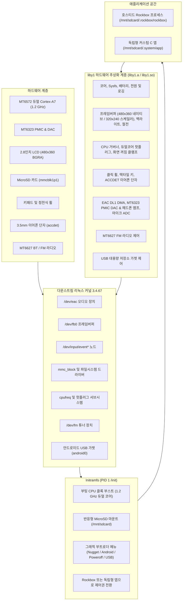
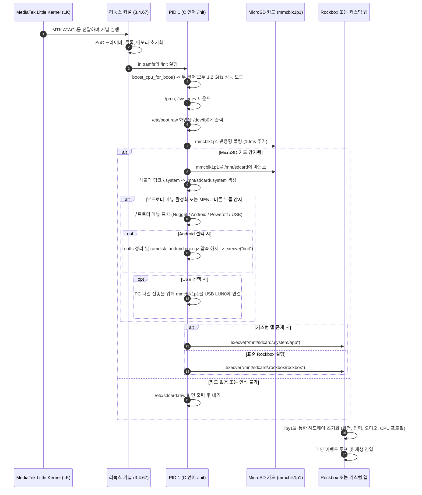

🌐 **한국어** | [English](../ARCHITECTURE.md)

# 시스템 아키텍처: Innioasis Y1 호스티드 리눅스 포트

이 문서는 최소 구성 다운스트림 리눅스 기반 Innioasis Y1 Rockbox 포트 및 `liby1` 하드웨어 SDK의 소프트웨어 아키텍처, 프로세스 모델, 부팅 수명 주기, 스토리지 계층 구조를 상세히 설명합니다.

---

## 1. 시스템 블록 다이어그램



---

## 2. 부팅 시퀀스 및 프로세스 수명 주기



---

## 3. 스토리지 계층 구조 및 파티션

하드웨어에는 내부 eMMC(`mmcblk0`)와 외장 MicroSD(`mmcblk1`)가 있습니다.

### 3.1 파티션 구성
- `mmcblk0` (내부 eMMC): 순정 MediaTek 파티션(`BOOTIMG`, `RECOVERY`, `LOGO`, `SYSTEM`, `CACHE`, `DATA`)을 포함합니다. Rockbox는 `BOOTIMG` 파티션만 `boot_rockbox.img`(최대 6 MiB)로 덮어쓰며, eMMC의 나머지 영역은 마운트하지 않고 보존합니다.
- `mmcblk1p1` (외장 MicroSD): FAT32, exFAT, NTFS 또는 ext4로 포맷됩니다. 시스템 라이브러리, 하드웨어 SDK 자산, 사용자 애플리케이션 데이터를 저장합니다:

```text
/mnt/sdcard/
|-- .system/                      # 시스템, 하드웨어 및 개발자 라이브러리 (/.system에 심볼릭 링크됨)
|   |-- lib/
|   |   |-- liby1.so              # liby1 동적 공유 라이브러리
|   |   |-- liby1.a               # liby1 정적 라이브러리
|   |   `-- liby1video.so         # NEON H.264/AAC 하드웨어 비디오 디코더
|   |-- include/
|   |   `-- liby1.h               # 공개 C 헤더 파일
|   |-- bin/
|   |   `-- ffmpeg                # 정적 ARM FFmpeg 실행 파일 (선택 사항)
|   |-- bt/                       # 블루투스 커널 모듈 및 펌웨어
|   |-- bt_paired.dat             # 페어링된 기기 데이터베이스
|   |-- ramdisk_android.cpio.gz   # 듀얼 부팅용 순정 안드로이드 램디스크
|   |-- y1_debug.txt              # 하드웨어 진단 로그
|   |-- system.cfg                # 부트로더 메뉴 설정 파일
|   |-- *.raw                     # 스플래시 및 부트로더 메뉴 화면 파일
|   `-- app                       # 부팅 시 즉시 실행 가능한 독립형 사용자 애플리케이션
|-- .rockbox/                     # 순수 Rockbox 전용 자산 디렉터리
|   |-- rockbox                   # ELF ARM hard-float 실행 파일
|   |-- codecs/                   # 오디오 디코더 (.codec)
|   |-- rocks/                    # 플러그인 (.rock, .ovl)
|   |-- fonts/                    # UI 글꼴 (.fnt, .fnticons)
|   |-- themes/                   # 테마 설정 (.cfg)
|   |-- wps/                      # 재생 화면 스킨 (.wps, .sbs)
|   `-- config.cfg                # Rockbox 설정 파일
|-- Videos/                       # 비디오 파일 디렉터리
`-- Music/                        # 음악 라이브러리
```

---

## 4. 하드웨어 추상화 계층 (`liby1`) 매핑

| 서브시스템 | `liby1` 모듈 | 기술적 역할 |
| :--- | :--- | :--- |
| 코어 / 전원 / 배터리 | [`hosted_linux_port/liby1/src/y1_core.c`](file:///c:/Users/dakirb/Documents/rom/!rockbox_fromsource/rockbox-master/rockbox-master/hosted_linux_port/liby1/src/y1_core.c) | 시스템 전역 초기화, MT6323 PMIC 레지스터 접근, 배터리 텔레메트리, `/mnt/sdcard/.system/y1_debug.txt` 진단 로깅. |
| 디스플레이 및 백라이트 | [`hosted_linux_port/liby1/src/y1_display.c`](file:///c:/Users/dakirb/Documents/rom/!rockbox_fromsource/rockbox-master/rockbox-master/hosted_linux_port/liby1/src/y1_display.c) | 프레임버퍼 쓰기 (`/dev/graphics/fb0`), 480x360 네이티브, 320x240 클래식 양선형 업스케일러, 커널 조기 일시정지(`early_suspend`). |
| CPU 주파수 및 핫플러그 | [`hosted_linux_port/liby1/src/y1_cpu.c`](file:///c:/Users/dakirb/Documents/rom/!rockbox_fromsource/rockbox-master/rockbox-master/hosted_linux_port/liby1/src/y1_cpu.c) | cpufreq 주파수 제어 (598MHz 저전력 ~ 1.3GHz 터보), CPU1 코어 오프라인화, 화면 꺼짐 클램프. |
| 입력 및 클릭 휠 | [`hosted_linux_port/liby1/src/y1_input.c`](file:///c:/Users/dakirb/Documents/rom/!rockbox_fromsource/rockbox-master/rockbox-master/hosted_linux_port/liby1/src/y1_input.c) | 클릭 휠, 택타일 버튼, ACCDET 3.5mm 이어폰 단자에서 들어오는 `evdev` 이벤트 수신 및 매핑. |
| 오디오 서브시스템 | [`hosted_linux_port/liby1/src/y1_audio.c`](file:///c:/Users/dakirb/Documents/rom/!rockbox_fromsource/rockbox-master/rockbox-master/hosted_linux_port/liby1/src/y1_audio.c) | `/dev/eac` AFE DL1 DMA 설정, MT6323 PMIC DAC 및 헤드폰 앰프 게인 제어, 4바이트 프레임 정렬, 딥 아이들 SPM 파워다운 제어. |
| FM 라디오 튜너 | [`hosted_linux_port/liby1/src/y1_tuner.c`](file:///c:/Users/dakirb/Documents/rom/!rockbox_fromsource/rockbox-master/rockbox-master/hosted_linux_port/liby1/src/y1_tuner.c) | `/dev/fm` ioctl을 통한 MT6627 FM 라디오 주파수 튜닝 및 신호 수신. |
| USB 가젯 | [`hosted_linux_port/liby1/src/y1_usb.c`](file:///c:/Users/dakirb/Documents/rom/!rockbox_fromsource/rockbox-master/rockbox-master/hosted_linux_port/liby1/src/y1_usb.c) | PC 음악/파일 전송을 위한 Android USB Mass Storage LUN0 바인딩 및 분리. |
