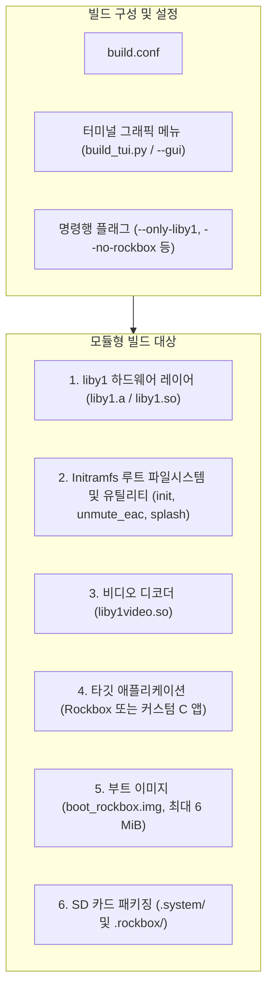

🌐 **한국어** | [English](../BUILD_GUIDE.md)

# Innioasis Y1 모듈식 빌드 시스템 및 구성 가이드

이 문서는 **Innioasis Y1 호스티드 리눅스 포트** 및 **`liby1` 하드웨어 SDK**를 위한 분리형 모듈식 빌드 아키텍처, 빌드 설정 옵션, 대화형 터미널 GUI (TUI), 명령행 플래그 및 기기 배포 절차를 상세히 안내합니다.

---

## 1. 분리형 모듈식 아키텍처 개요

Innioasis Y1 소프트웨어 스택은 서로 독립적인 모듈형 구성 요소로 분리되어 있습니다:



### 핵심 아키텍처 장점
1. **Rockbox와의 완전한 분리:** Rockbox 소스 트리가 전체 빌드 시스템에 강결합되지 않습니다. Rockbox를 컴파일하지 않고도 순수 최소 리눅스 SDK 및 부트 이미지를 빌드할 수 있으며, 개발자가 작성한 서드파티 C 바이너리를 단독으로 패키징할 수 있습니다.
2. **독립된 `.system` 스토리지 구조:** 모든 시스템 라이브러리(`liby1.so`), 헤더(`liby1.h`), 블루투스 커널 모듈(`bt/`), 스플래시 화면(`*.raw`), 진단 로그(`y1_debug.txt`)는 `/mnt/sdcard/.system/`(`/.system`에 심볼릭 링크 연결)에 저장됩니다. Rockbox 고유 파일은 순수하게 `/mnt/sdcard/.rockbox/` 내부에만 보관됩니다.
3. **하드웨어 추상화 레이어 (`liby1`):** Rockbox와 독립형 커스텀 애플리케이션 모두 종속성이 없는 단일 C 라이브러리(`liby1`)를 공통으로 링크하여 동작합니다.
4. **대화형 TUI 설정:** 터미널 기반 그래픽 메뉴(`build.sh --gui`)를 통해 셸 스크립트를 직접 수정하지 않고도 빌드 구성 요소를 켜고 끄거나 컴파일 작업 수를 시각적으로 조절할 수 있습니다.

---

## 2. 사전 준비 사항

### 호스트 운영체제
- **지원 OS:** Ubuntu 20.04 이상, Debian 11 이상, WSL2 (Windows 10/11 기반 Linux용 Windows 하위 시스템).
- **아키텍처:** x86_64 또는 aarch64.

### 필수 패키지 설치
ARM 크로스 컴파일러 툴체인, Python 3, 압축 도구 및 빌드 유틸리티를 설치합니다:
```bash
sudo apt update
sudo apt install -y \
    build-essential \
    gcc-arm-linux-gnueabihf \
    g++-arm-linux-gnueabihf \
    python3 \
    python3-pip \
    zip \
    curl \
    ccache
```

---

## 3. 빌드 설정 및 대화형 터미널 GUI (TUI)

빌드 환경은 대화형 터미널 GUI를 실행하거나 `hosted_linux_port/build.conf` 파일을 직접 편집하여 구성할 수 있습니다.

### 3.1 터미널 GUI 실행
`hosted_linux_port/` 디렉터리에서 아래 명령 중 하나를 실행합니다:
```bash
./build.sh --gui
# 또는:
./build.sh menuconfig
# 또는 Python 스크립트 직접 실행:
python3 tools/build_tui.py build.conf
```

#### GUI 조작법
* **위 / 아래 방향키 (또는 `k` / `j`):** 설정 항목 및 퀵 액션 간 이동.
* **스페이스바 (Space):** 체크박스 토글 `[X]` / `[ ]` 또는 텍스트 입력창 열기.
* **엔터 (Enter):** 선택한 액션 실행 또는 값 변경.
* **`S`:** 설정을 `build.conf`에 저장하고 종료.
* **`B`:** 설정을 저장하고 즉시 빌드 시작.
* **`Q` (또는 `ESC`):** 저장하지 않고 종료.

### 3.2 구성 파일 (`build.conf`)
[`hosted_linux_port/build.conf`](../../build.conf)에 위치하며 세부 옵션은 다음과 같습니다:

| 항목 | 기본값 | 설명 |
| :--- | :--- | :--- |
| `BUILD_LIBY1` | `1` | 독립형 C 하드웨어 라이브러리(`liby1.a`, `liby1.so`, `hello_y1`) 빌드 여부. |
| `BUILD_ROOTFS` | `1` | 최소 루트 파일시스템 구성, 스플래시 이미지 RAW 변환, `init` 및 `unmute_eac` 컴파일 여부. |
| `BUILD_BOOTIMG` | `1` | 루트 파일시스템을 `ramdisk_rockbox.img`로 묶고 MTK 커널 부트 이미지(`boot_rockbox.img`)를 생성할지 여부. |
| `BUILD_VIDEO_LIB` | `1` | 하드웨어 비디오 가속 라이브러리 `liby1video.so`(NEON H.264/AAC) 빌드 여부. |
| `BUILD_ROCKBOX` | `1` | Innioasis Y1 대상 Rockbox 애플리케이션(`build_y1/`) 빌드 여부. |
| `PACKAGE_SDCARD` | `1` | SD 카드 배포용 아카이브(`rockbox_sdcard.zip` 또는 `y1_sdcard.zip`) 패키징 여부. |
| `BUNDLE_BT_BLOBS` | `1` | MediaTek MT6572/MT6627 블루투스 커널 모듈 및 펌웨어를 `/.system/bt/`에 번들링할지 여부. |
| `BUNDLE_ANDROID_RAMDISK` | `1` | 순정 안드로이드 램디스크를 `/.system/ramdisk_android.cpio.gz`에 복사하여 부트로더 메뉴 듀얼 부팅 지원. |
| `CUSTOM_APP_BIN` | `""` | `/.system/app`에 설치할 커스텀 ARM 바이너리 경로 (설정 시 부팅 시 Rockbox 대신 실행됨). |
| `CROSS_COMPILE` | `"arm-linux-gnueabihf-"` | ARM 크로스 컴파일러 접두사. |
| `USE_CCACHE` | `1` | `ccache`를 통한 증분 C 컴파일 가속 활성화 여부. |
| `JOBS` | `0` | 병렬 make 작업 수 (`0`으로 설정 시 `nproc`을 통해 CPU 코어 수 자동 감지). |

---

## 4. 명령행 플래그 및 빠른 빌드

`build.sh`는 스크립트 자동화 및 빠른 부분 빌드를 위해 다양한 명령행 인수를 지원합니다:

### 전체 표준 빌드 (Rockbox + 커널 부트 이미지 + SD 카드 패키지)
```bash
./build.sh
```

### GitHub 릴리즈 배포 패키지 빌드 (dist/)
GitHub 릴리즈에 바로 업로드할 수 있는 모든 배포용 파일을 한 번에 빌드하고 패키징합니다:
```bash
# 원스텝 릴리즈 배포 빌드:
./build.sh --dist
# 또는 패키징 스크립트 직접 실행:
./tools/make_dist.sh
```
이 명령은 모든 구성 요소를 컴파일하고, `liby1-sdk.zip`을 묶고, `sha256sums.txt` 무결성 검증값을 계산하여 `hosted_linux_port/dist/` 디렉터리에 다음 파일들을 생성합니다:
* `dist/boot_rockbox.img` (플래시용 MT6572 커널 부트 이미지)
* `dist/rockbox_sdcard.zip` (전체 MicroSD 배포 압축 파일: `.rockbox/` + `.system/`)
* `dist/liby1-sdk.zip` (C 하드웨어 계층 헤더, 정적/공유 라이브러리 및 예제)
* `dist/sha256sums.txt` (SHA-256 암호화 체크섬)
* `dist/RELEASE_NOTES.md` (릴리즈 노트 템플릿)

### 독립형 Linux SDK 빌드 (Rockbox 제외)
Rockbox를 컴파일하지 않고 `liby1`, 리눅스 rootfs, 부트 이미지, SD 카드 `.system/` SDK 패키지만 빠르게 빌드합니다:
```bash
./build.sh --no-rockbox
```

### 특정 구성 요소 전용 빠른 빌드
```bash
# liby1만 빌드 (liby1.a, liby1.so, examples/hello_y1)
./build.sh --only-liby1

# Linux initramfs 루트 파일시스템 및 네이티브 유틸리티만 빌드 (init, unmute_eac)
./build.sh --only-rootfs

# liby1, rootfs, 플래시용 boot_rockbox.img만 빌드
./build.sh --only-bootimg

# 비디오 디코더 라이브러리만 빌드 (liby1video.so)
./build.sh --only-video
```

### 커스텀 C 애플리케이션 배포
`liby1`을 활용해 독립된 애플리케이션을 작성한 경우:
```bash
./build.sh --no-rockbox --custom-app /path/to/my_arm_app
```
빌드 시스템이 해당 실행 파일을 SD 카드 아카이브의 `/.system/app`에 배치합니다. 기기가 부팅되면 `/init`이 이를 감지하여 해당 애플리케이션을 자동으로 실행합니다.

---

## 5. 생성되는 빌드 결과물

빌드가 완료되면 `hosted_linux_port/` 디렉터리에 다음 파일들이 생성됩니다:

| 결과물 파일 | 크기 | 설명 |
| :--- | :--- | :--- |
| `boot_rockbox.img` | $\le$ 6 MiB | **플래시용 부트 이미지:** MT6572 벤더 리눅스 커널과 최소 initramfs 램디스크(`/init`, BusyBox, glibc 런타임)를 포함합니다. 기기의 `BOOTIMG` 파티션에 플래시합니다. |
| `rockbox_sdcard.zip` | 약 15–30 MB | **전체 SD 카드 배포판:** `.rockbox/`(Rockbox 바이너리, 코덱, 테마, 폰트) 및 `.system/`(하드웨어 라이브러리, 블루투스 모듈, 부트로더 화면)을 포함합니다. |
| `y1_sdcard.zip` | 약 5–10 MB | **독립형 SDK 배포판:** (`BUILD_ROCKBOX=0`일 때 생성) 순수 `.system/` 및 시스템 유틸리티로 구성됩니다. |
| `liby1/build/liby1.a` | 약 120 KB | `liby1` 정적 라이브러리 아카이브. |
| `liby1/build/liby1.so` | 약 90 KB | `liby1` 동적 공유 라이브러리. |

---

## 6. 기기 설치 및 플래시 가이드

### 1단계: `boot_rockbox.img` 플래시
> [!IMPORTANT]
> Innioasis Y1의 내부 eMMC `BOOTIMG` 파티션 최대 허용 크기는 **6,291,456 바이트 (6 MiB)**입니다. `build.sh`는 이 크기를 초과하지 않도록 자동으로 검증합니다.

#### 옵션 A: SP Flash Tool 사용 (MediaTek MT6572 권장)
1. PC에서 **SP Flash Tool**을 실행합니다.
2. 기기 덤프에 포함된 산란 파일(`MT6572_Android_scatter.txt`)을 로드합니다.
3. 파티션 목록에서:
   - **`BOOTIMG` 파티션만** 체크합니다.
   - 다른 모든 파티션(`PRELOADER`, `RECOVERY`, `SYSTEM` 등)은 체크를 해제합니다.
   - `BOOTIMG`의 위치 경로를 더블 클릭하여 `hosted_linux_port/boot_rockbox.img`를 지정합니다.
4. **Download** 버튼을 누릅니다.
5. Y1의 전원을 완전히 끈 후, 센터 또는 메뉴 버튼을 누른 채로(또는 바로) USB 케이블을 PC에 연결합니다. 3초 이내에 플래시가 완료됩니다.

#### 옵션 B: Fastboot 사용 (부트로더 언락 상태인 경우)
```bash
fastboot flash boot hosted_linux_port/boot_rockbox.img
fastboot reboot
```

### 2단계: SD 카드 리소스 설치
1. MicroSD 카드를 **FAT32** (또는 exFAT)로 포맷합니다.
2. 생성된 `rockbox_sdcard.zip`의 압축을 MicroSD 카드 루트 경로에 그대로 풉니다:
   ```text
   / (SD 카드 루트)
   |-- .system/
   |   |-- lib/
   |   |   |-- liby1.so
   |   |   |-- liby1video.so
   |   |-- include/
   |   |   |-- liby1.h
   |   |-- bt/
   |   |-- ramdisk_android.cpio.gz
   |   |-- y1_debug.txt
   |   |-- bootl_*.raw
   |-- .rockbox/
   |   |-- rockbox
   |   |-- codecs/
   |   |-- rocks/
   |   |-- wps/
   |-- Videos/
   ```
3. MicroSD 카드를 Y1 슬롯에 삽입하고 전원을 켭니다.

---

## 7. 듀얼 부팅 및 부트로더 메뉴

initramfs `/init`은 애플리케이션 시작 전에 그래픽 기반 부트로더 메뉴를 제공합니다:
* **Pick 1 (Nugget):** Rockbox 또는 커스텀 앱으로 부팅합니다.
* **Pick 2 (Android):** 루트 파일시스템을 순정 안드로이드 램디스크(`ramdisk_android.cpio.gz`)로 교체하고 안드로이드 OS로 부팅합니다.
* **Pick 3 (Shut Down):** 기기 전원을 안전하게 끕니다.
* **Pick 4 (USB Mode):** MicroSD를 USB 대용량 저장소(Mass Storage)로 호스트 PC에 연결하여 음악/파일 전송 모드로 전환합니다.

### 메뉴 강제 진입 (메뉴 버튼 바이패스)
기기 전원을 켤 때 **MENU** 버튼을 누르고 있으면 설정 파일(`.system/system.cfg`)의 자동 부팅 설정과 상관없이 **항상** 부트로더 메뉴 화면에 즉시 진입합니다.

