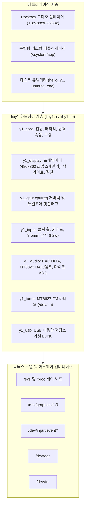

🌐 **한국어** | [English](../LIBY1_GUIDE.md)

# `liby1` — Innioasis Y1 하드웨어 추상화 레이어 및 개발자 매뉴얼

`liby1`은 **Innioasis Y1**(MediaTek MT6572 SoC, MT6323 PMIC, MT6627 무선 칩셋)의 모든 하드웨어 드라이버, sysfs 제어 노드, 커널 ioctl 인터페이스를 감싸는 외부 종속성 제로의 독립형 C 라이브러리입니다.

개발자는 커널 레지스터 맵이나 저수준 ioctl을 역공학할 필요 없이, 검증된 공식 하드웨어 추상화 계층(HAL)을 활용하여 독립형 게임, 에뮬레이터, 커스텀 미디어 플레이어 및 유틸리티를 손쉽게 개발할 수 있습니다. Rockbox 역시 내부적으로 `liby1`을 기반으로 구동됩니다.

---

## 1. 아키텍처 및 설계 목적

### 왜 `liby1`인가?
기존에는 Innioasis Y1 하드웨어를 제어하는 C 코드가 Rockbox 타깃 소스 트리(`firmware/target/hosted/innioasis/y1/`) 내부에 강하게 결합되어 있어, Rockbox 외부에서 장치 기능을 활용하거나 독립형 소프트웨어를 작성하기가 어려웠습니다.

`liby1`은 하드웨어 제어 계층을 애플리케이션 로직과 완전히 분리합니다:



### 주요 특징
* **외부 종속성 제로:** 표준 C99/C11 및 리눅스 표준 헤더로 작성되어 추가 라이브러리 없이 glibc만으로 작동합니다.
* **이중 빌드 지원:** 단일 실행 파일 배포를 위한 정적 라이브러리(`liby1.a`)와 동적 공유 라이브러리(`liby1.so`)가 동시에 빌드됩니다.
* **스토리지 디렉터리 분리:** 모든 시스템 바이너리, 런타임 공유 라이브러리, 헤더 파일은 `/mnt/sdcard/.system/`(`/.system`에 심볼릭 링크 연결) 내에만 배치되어 Rockbox 디렉터리를 오염시키지 않습니다.

---

## 2. 디렉터리 구조 및 SD 카드 레이아웃

모든 시스템, 하드웨어 및 개발자 라이브러리 자산은 `/mnt/sdcard/.system/`에 깔끔하게 보관됩니다:

```text
/mnt/sdcard/
|-- .system/                      # 부팅 시 /.system 경로에 심볼릭 링크됨
|   |-- include/
|   |   `-- liby1.h               # liby1 C 공개 헤더 파일
|   |-- lib/
|   |   |-- liby1.so              # liby1 동적 공유 라이브러리
|   |   |-- liby1.a               # liby1 정적 라이브러리 아카이브
|   |   `-- liby1video.so         # NEON H.264/AAC 하드웨어 비디오 디코더
|   |-- bin/
|   |   `-- ffmpeg                # 정적 ARM FFmpeg 실행 파일 (선택 사항)
|   |-- bt/                       # 블루투스 펌웨어 및 커널 모듈 (*.ko)
|   |-- bt_paired.dat             # 페어링된 블루투스 기기 데이터베이스
|   |-- ramdisk_android.cpio.gz   # 듀얼 부팅용 순정 안드로이드 램디스크
|   |-- y1_debug.txt              # 시스템 하드웨어 진단 로그
|   `-- app                       # 부팅 시 즉시 실행 가능한 사용자 애플리케이션
|-- .rockbox/                     # 순수 Rockbox 전용 자산 디렉터리
|   |-- rockbox
|   `-- config.cfg
`-- Videos/
```

---

## 3. 서브시스템 API 레퍼런스

모든 선언은 [`hosted_linux_port/liby1/include/liby1.h`](../../liby1/include/liby1.h)에 정의되어 있습니다.

### 3.1 코어, 전원, 배터리 및 로깅 (`y1_core.c`)
하드웨어 서브시스템 전체 초기화, 전원 제어, 실시간 배터리 텔레메트리 및 `/mnt/sdcard/.system/y1_debug.txt` 진단 로깅을 담당합니다.

```c
#include "liby1.h"

// 수명 주기 관리
int  y1_init(void);     // 디스플레이, 백라이트, 입력, 오디오 기본 초기화
void y1_shutdown(void); // 안전한 하드웨어 종료 처리

// 진단 로깅
void y1_log_set_enabled(bool enabled);
void y1_log(const char *msg);
void y1_logf(const char *fmt, ...);

// 배터리 및 전원 측정
int  y1_battery_percent(void);    // 0 ~ 100 %
int  y1_battery_voltage_mv(void); // 예: 3850 mV
int  y1_battery_current_ma(void); // 실시간 방전/충전 전류 (mA)
bool y1_battery_is_charging(void);// 충전 중 여부
bool y1_power_usb_online(void);   // 5V USB 또는 충전기 연결 여부

// 시스템 전원 제어
void y1_sys_poweroff(void); // 시스템 안전 전원 끄기
void y1_sys_reboot(void);   // SoC 재부팅
```

### 3.2 디스플레이, 프레임버퍼, 백라이트 및 커널 절전 (`y1_display.c`)
480x360 해상도의 2.8인치 컬러 LCD(`/dev/graphics/fb0`)에 직접 접근하며, 하드웨어 오버레이 패닝, 클래식 모드 양선형(Bilinear) 업스케일러, 커널 조기 일시정지(`early_suspend`)를 지원합니다.

```c
// 프레임버퍼 초기화
int  y1_fb_init(void);
void y1_fb_close(void);
int  y1_fb_width(void);       // 480
int  y1_fb_height(void);      // 360
uint8_t *y1_fb_mmap_ptr(void);// 32비트 XRGB 메모리 매핑 포인터

// 화면 출력
void y1_fb_present_xrgb8888(const uint32_t *pixels_480x360);
void y1_fb_present_rgb565(const uint16_t *pixels_480x360);

// 매끄러운 320x240 -> 480x360 면적 평균 업스케일러 (클래식 모드)
void y1_fb_blit_rgb565_classic_scaled(const uint16_t *src_base, int src_stride_px,
                                      int x, int y, int width, int height,
                                      y1_pixel_blend_fn blend_cb, void *blend_user);

// RAW 스플래시 화면 직접 출력 (/.system/<name>.raw 로드)
bool y1_fb_display_raw_screen(const char *name, uint16_t *out_fb16,
                              int fb16_stride_px, bool classic_320x240);

// 백라이트 및 화면 절전
void y1_backlight_set_percent(int pct_0_to_100);
void y1_backlight_set_raw(int val_0_to_255);
void y1_display_enter_early_suspend(void); // LCD 클록, 터치 스캐닝, Mali GPU 전원 차단 ('mem')
void y1_display_exit_early_suspend(void);  // 화면 표시 및 컨트롤러 복구 ('on')
```

### 3.3 CPU 클록 거버너 및 코어 핫플러그 (`y1_cpu.c`)
MT6572의 동작 주파수와 보조 Cortex-A7 코어를 제어하여 배터리 소모를 극적으로 줄입니다.

```c
// CPU 동작 모드 설정
y1_cpu_set_mode(Y1_CPU_MODE_POWERSAVE);   // 598 MHz 고정 (최저 VCORE 전압 1.05V)
y1_cpu_set_mode(Y1_CPU_MODE_DYNAMIC);     // 동적 온디맨드 598 MHz - 1001 MHz
y1_cpu_set_mode(Y1_CPU_MODE_PERFORMANCE); // 1196 MHz 고정 (듀얼 코어)

// 듀얼 코어 핫플러그 제어
y1_cpu_set_dual_core(false);              // CPU1을 오프라인으로 전환하여 전력 절감
y1_cpu_set_dual_core(true);               // 멀티스레드 처리를 위해 CPU1 활성화
int freq = y1_cpu_get_freq_mhz();         // 현재 클록 주파수 조회 (MHz)
```

### 3.4 입력: 클릭 휠, 버튼 및 3.5mm 이어폰 단자 (`y1_input.c`)
`/dev/input/event*` 장치에서 이벤트를 논블로킹으로 수신하고, 정전식 휠 회전 및 이어폰 단자 연결 상태를 파악합니다.

```c
int y1_input_init(void);

struct y1_input_event ev;
// 논블로킹 입력 폴링 (timeout_ms: 0 = 즉시 반환, -1 = 무한 대기)
if (y1_input_poll(&ev, 100) > 0) {
    if (ev.value == 1) { // 키를 누른 경우
        switch (ev.button) {
            case Y1_BTN_SELECT:      /* 센터 선택 버튼 */ break;
            case Y1_BTN_MENU:        /* 메뉴 버튼 */ break;
            case Y1_BTN_PLAY:        /* 재생/일시정지 버튼 */ break;
            case Y1_BTN_SCROLL_FWD:  /* 휠 시계 방향 회전 */ break;
            case Y1_BTN_SCROLL_BACK: /* 휠 반시계 방향 회전 */ break;
            case Y1_BTN_VOL_UP:      /* 측면 볼륨 올림 (+) */ break;
            case Y1_BTN_VOL_DOWN:    /* 측면 볼륨 내림 (-) */ break;
            case Y1_BTN_HEADSET_MFB: /* 이어폰 인라인 리모컨 버튼 */ break;
        }
    }
}

// 3.5mm 이어폰 잭 감지
bool plugged = y1_jack_is_inserted(); // 잭 삽입 여부
bool has_mic = y1_jack_has_mic();     // 4극 마이크 탑재 이어폰 여부
```

### 3.5 오디오 서브시스템: EAC DMA 및 MT6323 DAC (`y1_audio.c`)
`/dev/eac` 장치를 통해 44.1 kHz 및 48 kHz 스테레오 오디오를 무손실 비트 퍼펙트(Bit-perfect)로 재생합니다.

```c
// 원하는 샘플 레이트(44100 또는 48000 Hz)로 오디오 장치 열기
if (y1_audio_open(44100) == 0) {
    // 헤드폰 앰프 아날로그 PGA 게인 설정 (0 ~ 7; 0 = -12 dB, 7 = +2 dB)
    y1_audio_set_hp_analog_gain(6, 6);

    // 16비트 인터리브 스테레오 PCM 프레임 쓰기
    // (4바이트 프레임 정렬을 DMA 드라이버가 내부 보장함)
    int16_t pcm_buffer[1024 * 2]; // 1024개 스테레오 프레임
    y1_audio_write_pcm(pcm_buffer, sizeof(pcm_buffer));

    // 사용 완료 후 닫기
    y1_audio_close();
}
```

### 3.6 FM 라디오 튜너 (`y1_tuner.c`)
MT6627 칩셋의 FM 라디오 수신기를 `/dev/fm` 인터페이스로 제어합니다.

```c
y1_fm_power(true);
y1_fm_tune(98500000); // 98.5 MHz
int rssi = y1_fm_get_rssi();
bool locked = y1_fm_is_tuned();
y1_fm_set_mute(false);
```

### 3.7 USB 대용량 저장소 가젯 (`y1_usb.c`)
물리 MicroSD 파티션(`/dev/block/mmcblk1p1`)을 PC 연결 시 USB 드라이브로 마운트합니다.

```c
// PC와의 파일 전송을 위해 USB Mass Storage 드라이브 활성화
y1_usb_attach_mass_storage();

// PC에서 사용자가 안전 제거를 수행했는지 감지
if (y1_usb_check_host_ejected()) {
    y1_usb_detach_mass_storage();
}
```

---

## 4. 독립형 애플리케이션 작성 및 컴파일

### 4.1 최소 예제 코드 (`examples/hello_y1.c`)
```c
#include <stdio.h>
#include <unistd.h>
#include "liby1.h"

int main(void) {
    if (y1_init() != 0) {
        fprintf(stderr, "liby1 초기화 실패\n");
        return 1;
    }

    y1_log("Innioasis Y1 독립형 C 애플리케이션 시작!");

    // 백라이트 밝기 70% 설정
    y1_backlight_set_percent(70);

    // 기본 RAW 스플래시 화면 출력
    y1_fb_display_raw_screen("boot", NULL, 0, false);

    printf("배터리: %d%% (%d mV)\n",
           y1_battery_percent(), y1_battery_voltage_mv());

    // 센터 버튼 또는 메뉴 버튼 입력 대기
    struct y1_input_event ev;
    bool running = true;
    while (running) {
        if (y1_input_poll(&ev, 100) > 0 && ev.value == 1) {
            if (ev.button == Y1_BTN_SELECT || ev.button == Y1_BTN_MENU) {
                running = false;
            }
        }
    }

    y1_shutdown();
    return 0;
}
```

### 4.2 Makefile을 이용한 빌드
```bash
# liby1.a, liby1.so 및 hello_y1 예제 빌드
make -C hosted_linux_port/liby1 CROSS_COMPILE=arm-linux-gnueabihf-
```

### 4.3 수동 컴파일 및 링크
정적 라이브러리(`liby1.a`)로 링크하여 단일 바이너리 생성:
```bash
arm-linux-gnueabihf-gcc -O2 \
    -Ihosted_linux_port/liby1/include \
    my_app.c \
    hosted_linux_port/liby1/build/liby1.a \
    -o my_app
```

동적 라이브러리(`liby1.so`)로 공유 링크:
```bash
arm-linux-gnueabihf-gcc -O2 \
    -Ihosted_linux_port/liby1/include \
    -Wl,-rpath,/.system/lib \
    my_app.c \
    -Lhosted_linux_port/liby1/build -ly1 \
    -o my_app
```

---

## 5. 기기 부팅 시 독립형 애플리케이션 자동 실행

Rockbox를 띄우지 않고 개발한 애플리케이션을 기기에서 바로 실행하려면:
1. 빌드한 ARM 실행 파일을 MicroSD 카드의 `/mnt/sdcard/.system/app`에 복사합니다.
2. 실행 권한을 부여합니다 (`chmod +x /mnt/sdcard/.system/app`).
3. Y1 기기 전원을 켭니다.
4. 리눅스 `/init`이 `/.system/app`의 존재를 감지하고, Rockbox 대신 해당 프로그램을 전체 하드웨어 권한으로 즉시 실행합니다.

